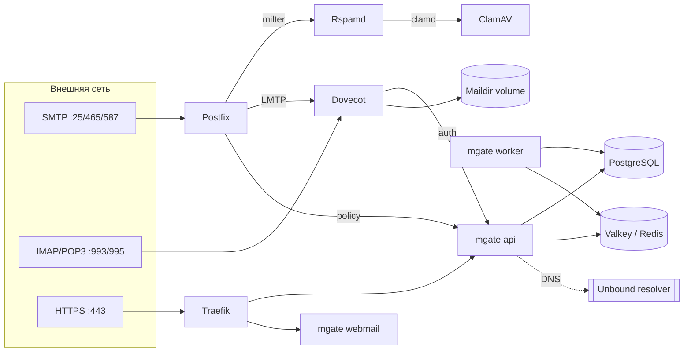

# MGate — Современная почтовая платформа

**MGate** — готовый, масштабируемый почтовый сервер «всё-в-одном» для самостоятельного развёртывания (self-hosted). Включает в себя почтовое ядро (Postfix, Dovecot), интеллектуальную защиту от спама и вирусов (Rspamd, ClamAV), современный веб-интерфейс для пользователей (Webmail), панель администратора, загрузку собственных TLS-сертификатов (автоматический выпуск Let's Encrypt — в разработке) и встроенный мастер настройки DNS.

---

## Что это

MGate предоставляет полноценную корпоративную и личную почтовую систему без привязки к внешним SaaS-провайдерам. Платформа полностью упакована в контейнеры и готова к развёртыванию в Docker Compose или Kubernetes (через официальный Helm-чарт).

### Компоненты платформы
- **Почтовые службы**: Postfix (MTA), Dovecot (IMAP/POP3/LMTP/ManageSieve).
- **Безопасность и фильтрация**: Rspamd (интеллектуальный антиспам, DKIM, SPF, DMARC, ARC), ClamAV (антивирусная проверка вложений).
- **Веб-интерфейсы**:
  - **Webmail**: современный, быстрый веб-клиент для работы с почтой.
  - **Admin Panel**: удобная веб-панель управления доменами, ящиками, алиасами, квотами и очередями.
  - **Личный кабинет**: самостоятельная смена пароля пользователями, пароли приложений, автоответчики и правила фильтрации (двухфакторная аутентификация TOTP — в разработке).
- **Инфраструктура**: встроенный обратный прокси Traefik (по умолчанию отдаётся самоподписанный сертификат, собственный сертификат загружается в админке; автоматический выпуск Let's Encrypt — в разработке), локальный DNS-резолвер Unbound, PostgreSQL и кэш сессий.

---

## Зачем нужен MGate

- **Полный контроль над данными**: письма, вложения и учетные записи хранятся на ваших собственных серверах или в защищённом S3-хранилище.
- **Высокая доставляемость писем**: автоматическая генерация DKIM-ключа (RSA-2048) при добавлении домена и ротация ключа по кнопке в админке, поддержка SPF, DMARC, ARC, публикация политики MTA-STS и отчётов TLS-RPT. Встроенный мастер DNS помогает настроить все необходимые записи без ошибок.
- **Установка за 5 минут**: готовый стек разворачивается одной командой, не требуя ручной настройки сотен строк конфигураций Postfix и Dovecot.
- **Современный стек безопасности**: надежное хеширование паролей Argon2id, пароли приложений для почтовых клиентов, изоляция сервисов, защита от перебора паролей и сетевой экран. Двухфакторная аутентификация (TOTP) — в разработке: сейчас вход выполняется только по паролю.
- **Масштабируемость**: поддержка как компактного развёртывания на одном сервере (Docker Compose), так и отказоустойчивых кластеров в Kubernetes (Helm).

---

## Возможности

- **Почтовые протоколы**: SMTP (25), SMTPS (465), Submission (587) с TLS; IMAP (143/993), POP3 (110/995), ManageSieve (4190).
- **Антиспам и защита**: Rspamd (эвристика, DNSBL/RBL, байесовские фильтры, greylisting), автоматическая проверка и подпись DKIM/ARC.
- **Антивирус**: ClamAV со сканированием входящих и исходящих вложений в реальном времени.
- **Мастер DNS**: автоматическая генерация всех необходимых DNS-записей (MX, A, SPF, DKIM, DMARC, MTA-STS, автоконфигурация почтовых клиентов) и проверка опубликованных записей по кнопке «Проверить DNS».
- **TLS-сертификаты**: по умолчанию самоподписанный; собственный сертификат (цепочка PEM и приватный ключ) загружается в админке. Автоматический выпуск Let's Encrypt — в разработке.
- **Панель администратора**:
  - Управление почтовыми доменами и квотами.
  - Почтовые ящики, псевдонимы (алиасы), перенаправления, списки рассылки, catch-all.
  - Мониторинг и управление очередью писем (отложенные, доставка, ручная очистка).
  - Журнал аудита действий администраторов.
  - Миграция почты по IMAP с Яндекс 360, Google Workspace, Mail.ru и любых IMAP-серверов: пакетный перенос администратором и самостоятельный перенос пользователем (перенос выполняется в фоне).
- **Веб-почта (Webmail)**:
  - Папки (создание, переименование и удаление своих папок; системные защищены), перемещение писем между папками и в «Спам», ветки переписки (треды), быстрый полнотекстовый поиск.
  - HTML-редактор писем, вложения drag-and-drop.
  - Адресная книга и автодополнение контактов.
  - Блокировка внешних трекеров и изображений для защиты приватности.
- **Личный кабинет пользователя**:
  - Смена паролей, пароли приложений для почтовых клиентов.
  - Двухфакторная аутентификация (TOTP) — **в разработке**: вход по одноразовому коду пока не работает и не включается.
  - Настройка серверных правил фильтрации писем (Sieve).
  - Уведомления об отпуске (автоответчик).
- **Резервное копирование и восстановление**:
  - Интегрированные сценарии бэкапа на базе restic (локально или в S3).
  - Восстановление почтовых баз и ящиков одной командой.
- **Мониторинг и метрики**:
  - Метрики Prometheus (`/metrics`) — только во внутренней сети, наружу через Traefik не публикуются.
  - Эндпоинты проверки состояния: `/api/v1/system/health` и `/api/v1/mail/health`.

---

## Архитектура



---

## Системные требования

- **Сервер / VPS**:
  - Публичный статический IPv4 (и опционально IPv6).
  - Открытый входящий и исходящий порт **25/TCP** (обратите внимание: многие облачные провайдеры блокируют порт 25 по умолчанию и требуют обращения в поддержку для его открытия).
  - Корректная обратная запись **rDNS (PTR)**, совпадающая с FQDN вашего почтового сервера.
- **Аппаратные ресурсы**:
  - **Минимум**: 2 vCPU, 4 GB RAM, 20 GB свободного места на диске. Без антивируса ClamAV (уберите `clamav` из `COMPOSE_PROFILES`) хватит 2 GB RAM.
  - **Рекомендуется** (полный стек с антивирусом ClamAV): 4 vCPU, 8 GB RAM, быстрый SSD/NVMe.
  - Профили нагрузки и таблица ресурсов — в [`docs/OPERATIONS.md`](docs/OPERATIONS.md).
  - Архитектура: **только linux/amd64 (x86_64)** — образы под arm64 пока не публикуются.
- **Программное обеспечение**:
  - Docker 25+ и Docker Compose v2.24+ (или Kubernetes 1.28+ при использовании Helm).
- **Домен**: собственный домен с доступом к редактированию DNS-записей.

---

## Как установить

### Автоматическая установка одной командой

На сервере Linux **x86_64** скачайте и запустите [установочный скрипт install.sh](https://raw.githubusercontent.com/mgate-server/mgate/main/scripts/install.sh):

```sh
curl -fsSL https://raw.githubusercontent.com/mgate-server/mgate/main/scripts/install.sh -o install-mgate.sh && sudo bash install-mgate.sh
```

Для запуска нужны Bash, `curl` и права root (`sudo`). Если `curl` отсутствует, на Debian/Ubuntu
установите его: `sudo apt-get update && sudo apt-get install -y curl ca-certificates`.

Установщик спросит почтовый домен (например `company.ru`), имя сервера (`mail.company.ru`)
и e-mail администратора. Затем скачает последний опубликованный релиз в `/opt/mgate`,
сгенерирует секреты, запустит весь стек через Docker Compose, дождётся готовности сервисов
и добавит почтовый домен через API. Исходники и инструменты сборки для запуска не нужны.

Перед запуском проверяются архитектура, RAM, CPU, свободное место в каталоге установки
и хранилище Docker, версии Engine/Compose, порты и пересечения подсетей с Docker/VPN.
Отсутствующие зависимости и Docker автоматически устанавливаются на Debian/Ubuntu
через [официальный apt-репозиторий Docker](https://docs.docker.com/engine/install/).
На других Linux или при конфликте существующих пакетов установщик выводит инструкцию.
DNS и PTR проверяются с подсказками; внешние DNS-записи и firewall провайдера настраиваются
вручную. Установка использует самоподписанный TLS-сертификат: собственный загрузите в панели.

Пароль администратора сохраняется в `MGATE_ADMIN_PASSWORD` файла `/opt/mgate/.env`
с правами `600`, без вывода в терминал. Посмотреть: `sudo less /opt/mgate/.env`.
Повторный запуск сохраняет существующий `.env`, версию и данные; это не команда обновления.
Для продолжения установки запустите `sudo bash /opt/mgate/scripts/install.sh`.

Все параметры — `bash install-mgate.sh --help`. Пример без вопросов, без ClamAV
(минимум 2 GB RAM), с явной версией:

```sh
sudo bash install-mgate.sh --domain company.ru --hostname mail.company.ru \
  --admin-email admin@company.ru --without-clamav --version 2026.10.1
```

Другой каталог задаётся через `--dir /srv/mgate`. Отключить автоустановку пакетов можно
параметром `--no-install-deps`; время ожидания — `--wait-timeout 1800` (по умолчанию 900 секунд,
первое скачивание антивирусных баз может занять несколько минут).

### Вариант 1. Docker Compose вручную

1. Клонируйте репозиторий и перейдите на последний релиз (список версий — на странице [Releases](https://github.com/mgate-server/mgate/releases)):
   ```sh
   git clone https://github.com/mgate-server/mgate.git
   cd mgate
   git checkout v<версия>   # например, v2026.10.1
   ```
   Ветка `main` — это снимок последнего релиза; для продакшена всё равно закрепляйте конкретный тег.

2. Инициализируйте конфигурацию и сгенерируйте криптостойкие секреты:
   ```sh
   make init
   ```
   Команда создаст файл `.env` из шаблона и автоматически сгенерирует уникальные пароли для баз данных и внутренних сервисов.

3. Отредактируйте файл `.env`:
   ```env
   MGATE_HOSTNAME=mail.example.com
   MGATE_ADMIN_EMAIL=admin@example.com
   ```
   `MGATE_ADMIN_EMAIL` — e-mail первого администратора.

   По умолчанию почтовые службы и веб-интерфейс используют **самоподписанный сертификат** для `MGATE_HOSTNAME`: браузеры и почтовые клиенты будут предупреждать о недоверенном сертификате. Для рабочей эксплуатации загрузите собственный сертификат (цепочка PEM и приватный ключ) в админке: **«Сертификаты» → «Загрузить сертификат»**. Автоматический выпуск и продление сертификатов Let's Encrypt — **в разработке**, в этой версии не работает.

   Образы берутся из реестра `MGATE_REGISTRY=ghcr.io/mgate-server` (значение по умолчанию, публичный анонимный доступ). `MGATE_VERSION` в `.env` должен быть равен версии выбранного релиза (например, `2026.10.1`, без префикса `v`) — подробнее в разделе [«Версии и обновление»](#версии-и-обновление).

4. Скачайте образы и запустите стек контейнеров:
   ```sh
   docker compose pull
   docker compose up -d
   ```

5. Проверьте запуск сервисов:
   ```sh
   docker compose ps
   make logs
   ```

Первый администратор создаётся автоматически. Если пароль не был указан в `.env` (`MGATE_ADMIN_PASSWORD` пуст), он генерируется и **выводится в лог инициализации один раз** — сохраните его сразу после первого запуска:
```sh
docker compose logs migrate | grep -A2 'initial superadmin'
```
Если пароль утерян, задайте новый командой `docker compose exec api mgate admin reset-password <MGATE_ADMIN_EMAIL>`.

### Вариант 2. Kubernetes / Helm

Для развёртывания в кластере Kubernetes доступен официальный Helm-чарт (`deploy/helm/mgate`):

```sh
git checkout v<версия>   # например, v2026.10.1
cd deploy/helm/mgate
helm install mgate . \
  --namespace mgate --create-namespace \
  --set config.hostname=mail.example.com \
  --set config.adminEmail=admin@example.com
```

Чарт берёт версию образов из `appVersion`, поэтому устанавливайте его из клона, переключённого на тег нужного релиза; явно версию можно задать через `--set global.imageTag=<версия>` (например, `2026.10.1`). Обновление — `git checkout v<новая>` и `helm upgrade mgate . --namespace mgate --reuse-values --set global.imageTag=<новая>`.

Подробнее о настройке внешних баз данных, Ingress и хранилища — в документации [`deploy/helm/mgate/README.md`](deploy/helm/mgate/README.md).

### Вариант 3. All-in-One образ

Монолитный образ «всё в одном» для тестирования и компактных инсталляций запланирован, но **пока не опубликован**. Сегодня поддерживаются Docker Compose и Helm; о появлении образа будет объявлено в [`CHANGELOG.md`](CHANGELOG.md).

---

## Образы

Все образы публикуются в GitHub Container Registry под организацией `mgate-server` ([список пакетов](https://github.com/orgs/mgate-server/packages)). Образы **публичные** — для скачивания не нужны ни логин, ни токен. Сейчас собирается только архитектура **linux/amd64**.

| Образ | Назначение |
|---|---|
| `ghcr.io/mgate-server/mgate` | закрытый backend: роли `api`, `webmail`, `worker`, `migrate` (распространяется только в виде образа) |
| `ghcr.io/mgate-server/mgate-agent` | агент для почтовых контейнеров (управление очередью, перезагрузка конфигурации, события) |
| `ghcr.io/mgate-server/web` | nginx + веб-интерфейс (админ-панель, личный кабинет, webmail) |
| `ghcr.io/mgate-server/postfix` | SMTP-сервер Postfix |
| `ghcr.io/mgate-server/dovecot` | IMAP/POP3/LMTP-сервер Dovecot |
| `ghcr.io/mgate-server/rspamd` | антиспам Rspamd (DKIM, SPF, DMARC, ARC) |
| `ghcr.io/mgate-server/unbound` | локальный DNSSEC-резолвер Unbound |
| `ghcr.io/mgate-server/traefik` | обратный прокси Traefik с автоматическими сертификатами |
| `ghcr.io/mgate-server/backup` | резервное копирование (restic) |
| `ghcr.io/mgate-server/firewall` | сетевой экран хоста (nftables, профиль `firewall`) |

**Теги.** Каждый релиз публикуется с тремя тегами:

- `2026.10.1` — точная версия, **неизменяемый** тег;
- `2026.10` — «плавающий» тег: последняя сборка месяца;
- `latest` — последний релиз.

Все десять образов одного релиза имеют одинаковую версию, поэтому достаточно одной переменной `MGATE_VERSION`.

---

## Версии и обновление

MGate использует календарное версионирование **CalVer `YYYY.M.N`**: год, месяц (без ведущего нуля) и порядковый номер сборки внутри месяца, начиная с 1. Например, `2026.10.1` — первая сборка октября 2026 года, `2026.10.2` — вторая. Это корректная SemVer-версия; git-теги имеют вид `v2026.10.1`, теги образов — без префикса `v`. Версия едина для всего продукта: все образы, Helm-чарт и backend.

Обновление до новой версии (Docker Compose):

Одной командой, включая первый переход с версии без обновлятора:

```sh
curl -fsSL https://raw.githubusercontent.com/mgate-server/mgate/main/scripts/update.sh | sudo bash -s -- --yes
```

Каталог установки определяется автоматически. Команда создаёт копию базы и настроек,
обновляет MGate до последнего стабильного релиза и подключает обновления из панели
на хостах с systemd. При необходимости добавьте `--dir /srv/mgate`.

Локальный запуск обновлятора: `sudo ./scripts/update.sh` либо
**Настройки сервера → Обновления** после подключения хостовой службы.
Проверка версии: `./scripts/update.sh --check`. Первый переход со старой версии и
восстановление описаны в [`docs/UPDATES.md`](docs/UPDATES.md). Ручная процедура:

1. Прочитайте [`CHANGELOG.md`](CHANGELOG.md) и сделайте резервную копию ([`docs/BACKUP.md`](docs/BACKUP.md)).
2. Переключите клон на новый релиз, чтобы `docker-compose.yml`, `.env.example` и скрипты соответствовали версии образов:
   ```sh
   git fetch --tags && git checkout v<новая>   # на ветке main достаточно git pull
   ```
3. Выполните `make init` — команда добавит в `.env` новые переменные, а существующие значения оставит нетронутыми (прежний файл сохраняется как `.env.bak`).
4. Укажите в `.env` `MGATE_VERSION=<новая>` (без префикса `v`).
5. Выполните:
   ```sh
   docker compose pull
   docker compose up -d
   ```
   Миграции базы данных применяются автоматически: сервис `migrate` отрабатывает первым.

**Откат**: `git checkout v<прежняя>`, прежнее значение `MGATE_VERSION` и те же `docker compose pull && docker compose up -d`; если новая версия уже изменила схему базы, восстановите базу из резервной копии, сделанной перед обновлением.

**В продакшене закрепляйте конкретную версию** (`MGATE_VERSION=2026.10.1`) и не используйте `latest`: тогда перезапуск сервера не подтянет неожиданные изменения. Подробности, включая откат, — в [`docs/DEPLOYMENT.md`](docs/DEPLOYMENT.md#5-обновления-и-пиннинг-версий).

---

## Как работать

### 1. Первый вход в панель управления
Откройте в браузере:
```
https://<MGATE_HOSTNAME>/admin
```
Войдите под администратором (`MGATE_ADMIN_EMAIL` и пароль из `MGATE_ADMIN_PASSWORD` либо сгенерированный пароль из лога `migrate`, см. выше). Двухфакторная аутентификация (TOTP) пока **в разработке**, поэтому используйте длинный уникальный пароль администратора.

### 2. Добавление почтового домена и настройка DNS
1. Перейдите в раздел **«Домены»** и нажмите **«Добавить домен»** (например, `example.com`).
2. Откройте вкладку **«DNS-записи»** добавленного домена.
3. Добавьте указанные записи в панели управления вашим DNS-провайдером:
   - **MX**: указывает на ваш почтовый сервер (`mail.example.com` с приоритетом 10).
   - **A / AAAA**: IP-адрес вашего сервера для поддомена почты.
   - **TXT (SPF)**: `v=spf1 mx ~all`
   - **TXT (DKIM)**: сгенерированный сервером публичный ключ (селектор `mgate._domainkey`).
   - **TXT (DMARC)**: `v=DMARC1; p=none; rua=mailto:...` (политику ужесточают поэтапно — см. [`docs/DNS.md`](docs/DNS.md)).
4. Встроенный мастер автоматически проверит корректность записей и подтвердит готовность домена к приёму и отправке почты.

### 3. Создание почтовых ящиков и алиасов
1. Перейдите в раздел **«Почтовые ящики»** нужного домена.
2. Нажмите **«Создать ящик»**, укажите логин (например, `user`), имя и задайте пароль.
3. При необходимости настройте алиасы (псевдонимы) в разделе **«Алиасы»** (например, `info@example.com` -> `user@example.com`).

### 4. Доступ к почте через Webmail
Пользователи могут работать с почтой через встроенный веб-интерфейс:
```
https://<MGATE_HOSTNAME>/mail
```
Логином является полный адрес электронной почты (например, `user@example.com`).

### 5. Настройка почтовых клиентов (Thunderbird, Apple Mail, Outlook, мобильные клиенты)
MGate поддерживает автоматическое определение настроек (Autoconfig / Autodiscover):
- **Входящая почта (IMAP)**:
  - Сервер: `<MGATE_HOSTNAME>`
  - Порт: `993` (SSL/TLS)
  - Имя пользователя: полный email-адрес
- **Исходящая почта (SMTP)**:
  - Сервер: `<MGATE_HOSTNAME>`
  - Порт: `465` (SSL/TLS) или `587` (STARTTLS)
  - Аутентификация: обязательна (те же логин и пароль)

### 6. Управление через консоль
В репозитории предусмотрен `Makefile` для удобного администрирования:

```sh
make ps          # Проверка состояния контейнеров (то же, что `docker compose ps`)
make logs        # Просмотр объединённых логов в реальном времени
make restart     # Перезапуск стека
make backup      # Создание немедленного резервного снимка почты и конфигураций
make restore     # Восстановление данных из бэкапа
```

---

## Документация для администратора

Подробные руководства по настройке и обслуживанию:

- [Развёртывание и установка](docs/DEPLOYMENT.md) — продакшен-установка, фаервол, системные тюнинги.
- [Конфигурация окружения](docs/CONFIGURATION.md) — справочник всех параметров `.env` и переменных конфигурации.
- [Руководство по DNS](docs/DNS.md) — детальная настройка SPF, DKIM, DMARC, MTA-STS, TLS-RPT и обратной зоны (PTR).
- [Резервное копирование и восстановление](docs/BACKUP.md) — расписание бэкапов, шифрование, выгрузка в S3, аварийное восстановление.
- [Эксплуатация и обслуживание](docs/OPERATIONS.md) — управление очередями, просмотр логов, ротация ключей DKIM, мониторинг.
- [Архитектура платформы](docs/ARCHITECTURE.md) — описание взаимодействия компонентов и сетевых потоков.
- [Редакции и лицензирование](docs/LICENSING.md) — Community и Pro, активация, какие данные передаются вендору.
- [Полный индекс документации](docs/README.md).

---

## Редакции и лицензия

MGate распространяется в двух редакциях:

- **Community (бесплатная)**: полнофункциональный почтовый сервер без ограничений по количеству почтовых ящиков, алиасов и объёму писем. Поддерживает 1 почтовый домен. Администраторы доменов (Domain Admin) и квоты доменов входят в Community.
- **Pro (коммерческая подписка)**: снимает лимит на число доменов и включает дополнительные Pro-модули. Сегодня работают: неограниченное число доменов, white-label брендинг (название продукта и логотип в шапке интерфейса и в заголовке вкладки; favicon, акцентный цвет, ссылка поддержки и футер сохраняются, но пока не отображаются) и DMARC Intelligence (полные адреса источников, история до 90 дней, скачивание исходных XML-отчётов). Остальные Pro-модули — Backup Center, Advanced Dashboard, расширенная мультиарендность (Multi-tenant RBAC), фоновая автоматизация DNS-Автопилота и приоритетные обновления — **в разработке**: в интерфейсе они помечены «В разработке», а их API отвечает `501 not_implemented`. Состав редакций и порядок активации — в [`docs/LICENSING.md`](docs/LICENSING.md), планы развития — в [`docs/ROADMAP.md`](docs/ROADMAP.md).

Условия использования регламентируются соглашением [`EULA.md`](EULA.md). Сторонние компоненты с открытым исходным кодом (Postfix, Dovecot, Rspamd, ClamAV и др.) сохраняют свои оригинальные лицензии, перечисленные в файле [`NOTICE`](NOTICE).

---

## Обратная связь

Сообщения об ошибках и предложения — через [issues](https://github.com/mgate-server/mgate/issues); правила и порядок приёма изменений — в [`CONTRIBUTING.md`](CONTRIBUTING.md). Об уязвимостях сообщайте приватно — см. [`SECURITY.md`](SECURITY.md).
