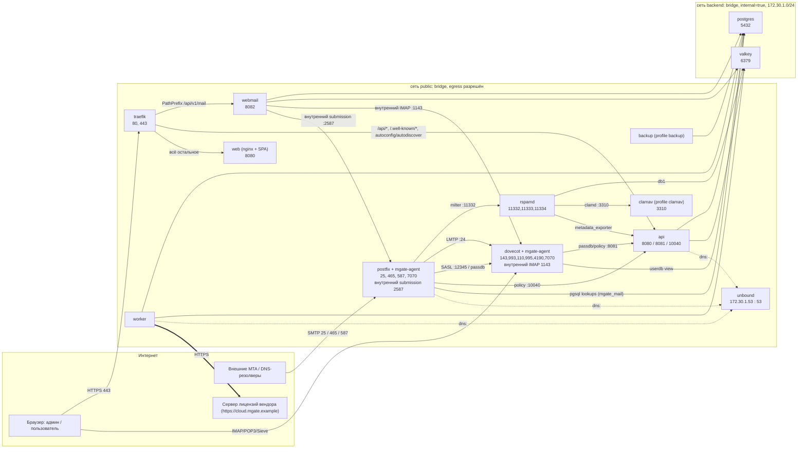
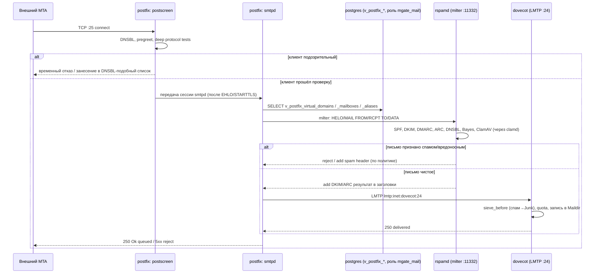
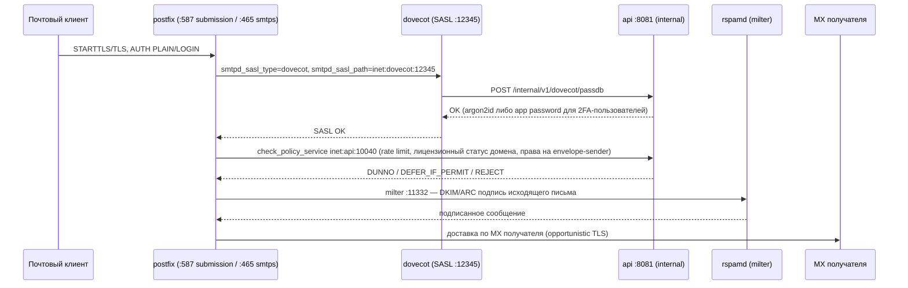
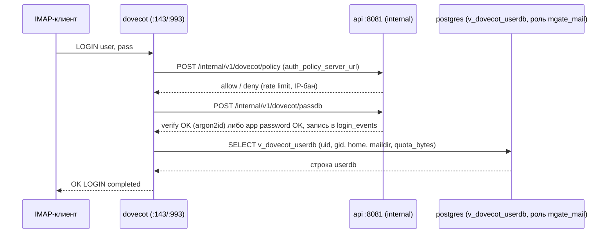
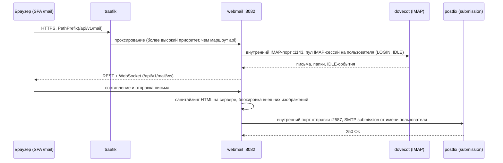
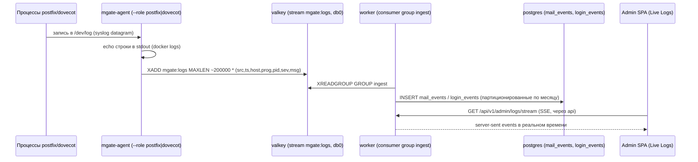
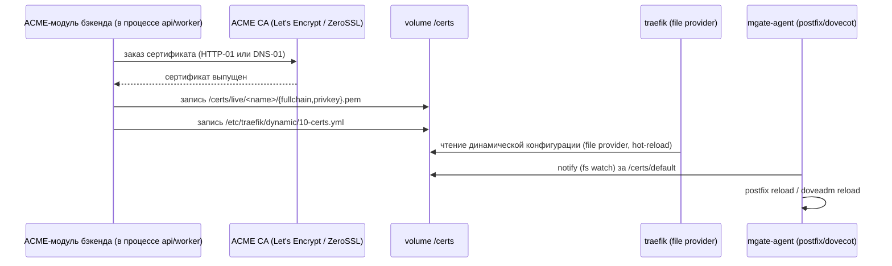
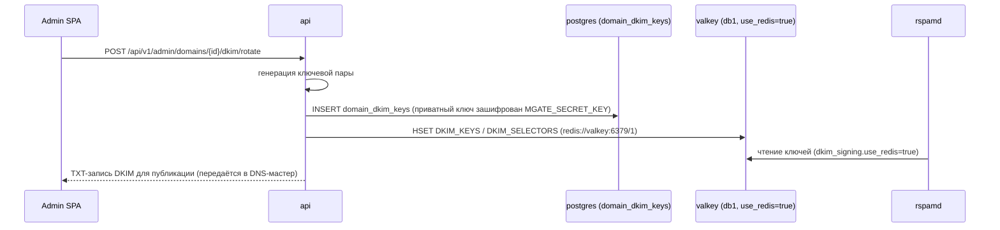
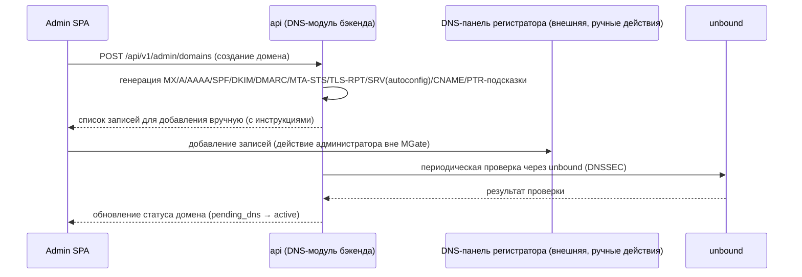
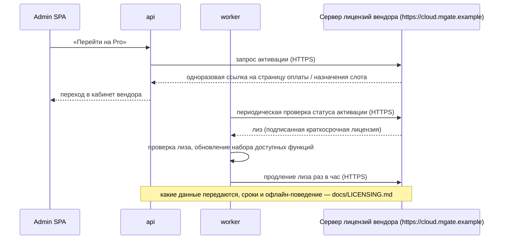

# Архитектура MGate

> Документ описывает архитектуру платформы для операторов и участников проекта: компоненты,
> сети, порты, тома, потоки данных и режимы отказа. Закрытый бэкенд описан как «чёрный ящик»
> (§7). Нормативные значения переменных окружения — [`CONFIGURATION.md`](CONFIGURATION.md);
> фактическая топология — `docker-compose.yml` этого репозитория.

## 1. Обзор

MGate — самостоятельно размещаемая (self-hosted) почтовая платформа: MTA/IMAP-стек
(Postfix + Dovecot 2.4 + Rspamd + ClamAV), PostgreSQL, Valkey, **закрытый бэкенд-сервис**
(`mgate`, распространяется только как образ, исходный код не публикуется — см. §7) и SPA на
React (админ-панель, личный кабинет пользователя, веб-почта, **исходный код открыт и лежит в
этом репозитории**), собранные в docker-compose (основной способ поставки), Helm-чарт и,
позже, всё-в-одном образ.

**Это не open-core.** В этом репозитории нет ни строки кода бэкенда — только deploy kit,
конфигурация почтового стека и SPA. Раздел §7 ниже описывает бэкенд как «чёрный ящик»:
задокументированные порты, эндпойнты, переменные окружения и то, чем он владеет в БД — этого
достаточно, чтобы эксплуатировать и адаптировать платформу, не имея его исходников.

Платформа поставляется в двух редакциях (подробности — `docs/LICENSING.md`; формат обмена с
сервером лицензий не публикуется):

- **Community** — бесплатная, полнофункциональный почтовый сервер, ограничена одним доменом
  (лимит задан внутри закрытого бэкенда);
- **Pro** — годовая подписка, снимает ограничение на количество доменов и включает
  Pro-модули, которые физически **уже присутствуют** в том же образе бэкенда и активируются
  верифицированной лицензионной арендой (lease) во время работы.

Есть ровно ОДИН образ бэкенда (`${MGATE_REGISTRY}/mgate`, по умолчанию
`ghcr.io/mgate-server/mgate`) — нет отдельной "Community-сборки" и "официальной сборки".
Редакция — не выбор при сборке, а результат проверки лицензии во время работы. Соответствующие
Pro-страницы SPA (`/admin/pro/*`) лежат в этом же публичном репозитории и точно так же гейтятся
во время работы по ответу `GET /api/v1/system/entitlements` — их видимость чисто косметическая,
реальная проверка происходит только на сервере (см. §9).

Честное ограничение, которое документация не скрывает: раз исходников бэкенда нет в открытом
доступе, тривиальный путь «форкнуть и вырезать проверку» отсутствует, но скомпилированный
бинарник всё равно может быть модифицирован решительным атакующим. Это не единственный рубеж
защиты — см. [ADR 0014](adr/0014-license-choice.md) (условия использования кода этого
репозитория + `EULA.md` на образы) и `docs/LICENSING.md` (какие данные передаются серверу
лицензий, привязка к инсталляции, короткий срок жизни аренды, серверная детекция клонов).
Формулировка «взлом невозможен» нигде не используется — только «повышает порог».

## 2. Компоненты и контейнеры

Примечания к диаграмме:
- `mgate-agent` не отдельный контейнер — это второй процесс внутри контейнеров `postfix` и
  `dovecot`: читает syslog (`/dev/log`), поднимает control API `:7070`,
  следит за `/certs/default` и вызывает reload. На диаграмме объединён с сервисом для краткости.
  `firewall` (профиль `firewall`, `network_mode: host`) не показан — он не входит ни в `public`,
  ни в `backend`, работает поверх сетевого стека хоста и подписан на Valkey `mgate:bans`.
  `mailpit` — только dev-оверлей (`docker-compose.dev.yml`), в production-топологии отсутствует.
- Стрелка `worker ⇒ CloudLic` — единственный исходящий канал к внешнему серверу лицензий
  (при активации к нему обращается и `api`), инициируется только изнутри установки; входящих
  соединений от сервера лицензий нет (см. §7 ниже и `docs/LICENSING.md` §5).

### 2.1 Состав сервисов (docker-compose, project name `mgate`)

`MGATE_REGISTRY` по умолчанию — `ghcr.io/mgate-server` (публичный реестр, скачивание без
авторизации). `MGATE_VERSION` — версия релиза в формате CalVer `ГГГГ.М.N` (например,
`2026.10.1`), единая для всех образов; про теги и пиннинг версий — [`DEPLOYMENT.md`](DEPLOYMENT.md#5-обновления-и-пиннинг-версий).

| Сервис    | Образ (по умолчанию)                              | Сети              | Публикуемые порты | Роль |
|-----------|----------------------------------------------------|-------------------|--------------------|------|
| traefik   | `${MGATE_REGISTRY}/traefik:${MGATE_VERSION}`       | public            | 80, 443            | реверс-прокси, TLS из файлов, записываемых `mgate` |
| web       | `${MGATE_REGISTRY}/web:${MGATE_VERSION}`           | public            | —                  | nginx: отдаёт собранную SPA + рантайм `/config.json`, генерируемый entrypoint'ом из переменных окружения |
| migrate   | образ `mgate`, cmd `migrate --bootstrap`            | backend           | —                  | одноразовое применение миграций, создание первого суперадмина и идентичности инсталляции |
| api       | `${MGATE_REGISTRY}/mgate:${MGATE_VERSION}` cmd `serve --components api,internal,policy` | public, backend | — | REST API, internal API, policy-сервис Postfix (SPA отдаёт отдельный сервис `web`) |
| webmail   | тот же образ, cmd `serve --components webmail`      | public, backend   | —                  | IMAP/SMTP-шлюз веб-почты (REST+WS) |
| worker    | тот же образ, cmd `worker`                          | public, backend   | —                  | фоновые задачи: ACME, продление лицензии, приём логов, статистика |
| postfix   | `${MGATE_REGISTRY}/postfix:${MGATE_VERSION}`       | public, backend   | 25, 465, 587       | MTA + `mgate-agent` (syslog, управление очередью, перезагрузка по сертификатам) |
| dovecot   | `${MGATE_REGISTRY}/dovecot:${MGATE_VERSION}`       | public, backend   | 143, 993, 110, 995, 4190 | IMAP/POP3/LMTP/Sieve + `mgate-agent` |
| rspamd    | `${MGATE_REGISTRY}/rspamd:${MGATE_VERSION}`        | public, backend   | —                  | milter, антиспам, DKIM/ARC-подпись |
| clamav    | `clamav/clamav:<pinned>` (профиль `clamav`)         | public, backend   | —                  | антивирус (clamd 3310) |
| postgres  | `postgres:18-alpine`                                | backend           | —                  | основная БД |
| valkey    | `valkey/valkey:9.0.6-alpine`                        | backend           | —                  | кэш, rate limit, стримы, IP-баны, данные rspamd (веб-сессии хранятся в PostgreSQL) |
| unbound   | `${MGATE_REGISTRY}/unbound:${MGATE_VERSION}`       | public, backend (статический IP `${MGATE_RESOLVER_IP:-172.30.1.53}`) | — | DNSSEC-валидирующий рекурсивный резолвер |
| backup    | `${MGATE_REGISTRY}/backup:${MGATE_VERSION}` (профиль `backup`) | public, backend | — | restic + pg_dump, cron |
| firewall  | `${MGATE_REGISTRY}/firewall:${MGATE_VERSION}` (профиль `firewall`) | host (`network_mode: host`) | — | опциональные nftables-баны по данным Valkey |
| mailpit   | `axllent/mailpit` (только dev-оверлей)              | backend           | 8025 (dev)         | перехват исходящей почты в разработке |

Источник истины по образам, портам и сетям — `docker-compose.yml` (и Helm-чарт
`deploy/helm/mgate/` для Kubernetes); таблица выше — их читаемое изложение и обновляется
вместе с ними.

## 3. Сетевая сегментация

Две docker-сети:

- **`public`** (bridge, egress разрешён) — сервисы, которые публикуют порты наружу или сами
  обращаются в интернет (ACME, DNS, отправка почты, клиент лицензирования).
- **`backend`** (bridge, `internal: true`, подсеть `${MGATE_BACKEND_SUBNET:-172.30.1.0/24}`) —
  без выхода в интернет; здесь недоступны никакие внешние адреса, включая сервер лицензий —
  сервисы, которым нужен только PostgreSQL/Valkey, дополнительно подключены и к `backend`.

Практически все сервисы, кроме `postgres`/`valkey` (только `backend`) и `unbound`
(оба + статический IP в `backend`), подключены **к обеим** сетям, потому что им нужен и
доступ к БД/кэшу (`backend`), и (для большинства) выход наружу или приём внешних
соединений (`public`). Изоляция обеспечивается не столько разделением на сети как таковым,
сколько тем, что `backend` не имеет `internet`-доступа: скомпрометированный процесс с
доступом только к `backend` не может достучаться наружу иначе как через сервисы,
явно проксирующие наружу (ACME, клиент лицензирования в `worker`), что дополнительно ограничено
кодом, а не сетевой политикой (подробности угроз — `docs/SECURITY.md`, обоснование модели —
`docs/adr/0016-network-segmentation-internal-auth.md`).

### Кто с кем говорит (who-talks-to-whom)

| Инициатор | Получатель | Канал | Назначение |
|-----------|-----------|-------|------------|
| Браузер / внешний клиент | traefik :443/:80 | HTTPS/HTTP | SPA, API, ACME HTTP-01 challenge |
| traefik | web :8080 | HTTP | всё, кроме `/api/*`, `/.well-known/*` и `/api/v1/mail*` — отдаёт SPA |
| traefik | api :8080 | HTTP | `/api/*`, `/.well-known/*`, autoconfig/autodiscover |
| traefik | webmail :8082 | HTTP/WS | `PathPrefix(/api/v1/mail)` (наивысший приоритет маршрутизации) |
| Внешний MTA | postfix :25 | SMTP | входящая почта |
| Почтовый клиент (MUA) | postfix :465/:587 | SMTPS/Submission | исходящая почта |
| Почтовый клиент (MUA) | dovecot :143/:993/:110/:995/:4190 | IMAP(S)/POP3(S)/ManageSieve | доступ к ящику |
| postfix | rspamd :11332 | milter | проверка и подпись писем |
| postfix | dovecot :24 | LMTP | финальная доставка |
| postfix | dovecot :12345 | SASL (auth-client) | проверка учётных данных отправителя |
| postfix | api :10040 | policy delegation | rate limit, статус лицензии домена |
| postfix | dovecot :12340 | policy delegation | quota-status |
| postfix | postgres :5432 (роль `mgate_mail`) | SQL (`pgsql:` maps) | `v_postfix_*` представления |
| dovecot | api :8081 | HTTP (internal) | passdb, auth-policy |
| dovecot | postgres :5432 (роль `mgate_mail`) | SQL | `v_dovecot_userdb` |
| rspamd | valkey :6379 db1 | Redis-протокол | Bayes, ratelimit, DKIM/ARC-ключи |
| rspamd | clamav :3310 | clamd-протокол | антивирус |
| rspamd | api :8081 | HTTP (internal) | `metadata_exporter` события |
| api / webmail / worker | postgres :5432 (роль `mgate`) | SQL | основные данные, веб-сессии (в БД хранится только хэш токена) |
| webmail | dovecot :1143 | IMAP (STARTTLS) | внутренний IMAP-порт только для webmail-шлюза: чтение и управление ящиком от имени пользователя |
| webmail | postfix :2587 | SMTP (STARTTLS) | внутренний порт отправки только для webmail-шлюза |
| api / webmail / worker | valkey :6379 db0 | Redis-протокол | rate limit, стрим логов, IP-баны (веб-сессии хранятся в PostgreSQL) |
| api (модуль ACME внутри бэкенда) | valkey :6379 db0 | Redis-протокол | `mgate:acme:http01:<token>` (TTL 1ч) — ответ на ACME HTTP-01 challenge, читается любой репликой `api` |
| api / worker / postfix / dovecot (через `mgate-agent`) | unbound :53 | DNS | резолвинг с DNSSEC-валидацией |
| worker (и api при активации) | `https://cloud.mgate.example` (внешний сервер лицензий вендора) | HTTPS | активация/продление лицензии (что передаётся — `docs/LICENSING.md` §5) |
| mgate-agent (postfix/dovecot) | api :8081 `/internal/v1/events/dovecot` | HTTP | события dovecot (опционально, наряду с rspamd `metadata_exporter`) |
| backup | postgres, `/backups` | `pg_dump`, restic | резервное копирование |
| firewall (`mgate-agent --role firewall`) | valkey pubsub `mgate:bans:events` | Redis-протокол | обновление набора nftables `mgate_ban` |

Всякий вызов `/internal/v1/*` и всякий control-вызов `mgate-agent` несёт
`Authorization: Bearer ${MGATE_INTERNAL_TOKEN}`; doveadm HTTP API — свой `DOVEADM_API_KEY`;
контроллер rspamd — `RSPAMD_CONTROLLER_PASSWORD`. Internal API (`:8081`) не проксируется
Traefik и физически доступен только из сети `backend`/`public` (не публикуется наружу).

## 4. Порты

### 4.1 Публикуемые на хост

| Сервис  | Порты | Протокол |
|---------|-------|----------|
| traefik | 80, 443 | HTTP, HTTPS |
| postfix | 25, 465, 587 | SMTP, SMTPS, Submission |
| dovecot | 143, 993, 110, 995, 4190 | IMAP, IMAPS, POP3, POP3S, ManageSieve |
| mailpit (только dev) | 8025 | HTTP (веб-интерфейс перехваченной почты) |

### 4.2 Внутренние (только сети `public`/`backend`, не публикуются)

| Компонент | Порт  | Протокол | Назначение |
|-----------|-------|----------|------------|
| api       | 8080  | HTTP     | публичный API `/api/v1/*`, `/.well-known/*`, autoconfig (SPA не отдаёт — см. сервис `web`) |
| api       | 8081  | HTTP     | internal API `/internal/v1/*`, `/metrics` |
| api       | 10040 | TCP      | Postfix policy delegation |
| webmail   | 8082  | HTTP+WS  | `/api/v1/mail/*`, `/api/v1/mail/ws` |
| postfix   | 2587  | SMTP (STARTTLS) | внутренний порт отправки только для webmail-шлюза: TLS/SASL/policy/milter как у 587, без лимитов anvil на IP клиента; принимает соединения только из сети бэкенда, не публикуется на хост |
| postfix   | 7070  | HTTP     | control API `mgate-agent` |
| dovecot   | 143   | IMAP (STARTTLS) | публичный IMAP для почтовых клиентов (публикуется на хост) |
| dovecot   | 1143  | IMAP (STARTTLS) | внутренний IMAP-порт только для webmail-шлюза (в compose — имя `dovecot-backend:1143`, только сеть `backend`); не публикуется на хост, в Kubernetes доступен только подам `webmail` |
| dovecot   | 24    | LMTP     | финальная доставка от Postfix |
| dovecot   | 12345 | auth/SASL| Postfix SASL |
| dovecot   | 12340 | policy   | quota-status |
| dovecot   | 8080  | HTTP     | doveadm HTTP API |
| dovecot   | 9900  | HTTP     | openmetrics |
| dovecot   | 7070  | HTTP     | control API `mgate-agent` |
| rspamd    | 11332 | milter   | proxy/milter (Postfix) |
| rspamd    | 11333 | HTTP     | normal worker |
| rspamd    | 11334 | HTTP     | controller (веб-UI/API rspamd) |
| clamav    | 3310  | clamd    | антивирус |
| postgres  | 5432  | PostgreSQL | основная БД |
| valkey    | 6379  | Redis    | кэш/rate limit/стримы/IP-баны |
| unbound   | 53    | DNS (udp+tcp) | резолвер |

Маршрутизация Traefik (какие пути куда проксируются) задана в образе `traefik`
(`docker/traefik/`); внешние порты и правила firewall хоста — [`DEPLOYMENT.md`](DEPLOYMENT.md) §2.

## 5. Тома (volumes)

| Том (имя, с префиксом проекта `mgate_`) | Точка монтирования | Кто пишет | Содержимое |
|------------------------------------------|---------------------|-----------|------------|
| `pg-data`       | `/var/lib/postgresql` (postgres 18) | postgres | данные PostgreSQL |
| `valkey-data`   | (data dir Valkey)      | valkey    | RDB/AOF снапшоты Valkey |
| `vmail`         | `/var/vmail`           | dovecot   | Maildir всех доменов/ящиков (`<domain>/<local>/Maildir`) |
| `postfix-spool` | `/var/spool/postfix`   | postfix   | очередь писем |
| `rspamd-data`   | (data dir rspamd)      | rspamd    | статистика, fuzzy storage (не DKIM-ключи — те в Valkey) |
| `clamav-db`     | (база сигнатур)        | clamav    | вирусные базы (`freshclam`) |
| `certs`         | `/certs`               | api/worker (модуль ACME внутри бэкенда), entrypoint-скрипты postfix/dovecot (bootstrap self-signed) | `/certs/live/<name>/{fullchain,privkey}.pem`, `/certs/default/{...}` |
| `proxy-dynamic` | `/etc/traefik/dynamic` | image entrypoint traefik (статические маршруты), api/worker (`10-certs.yml`) | динамическая конфигурация Traefik |
| `mgate-data`    | `/var/lib/mgate`       | api/worker | локальное состояние (не БД): временные файлы, кэш ACME account key и т.п. |
| `backups`       | bind `${MGATE_BACKUP_DIR:-./backups}` → `/backups` | backup | restic-репозиторий, дампы pg_dump |

## 6. Потоки данных

### 6.1 Входящая почта: postscreen → smtpd → rspamd milter → LMTP → Dovecot

### 6.2 Исходящая почта: Submission + SASL → passdb API, policy, DKIM-подпись

### 6.3 Вход в IMAP: passdb → API (argon2id / app password) + auth-policy

Примечание по механизму: используется Lua passdb через HTTP-клиент Dovecot 2.4
(`docker/dovecot/rootfs/etc/dovecot/lua/mgate-passdb.lua`), `checkpassword`-драйвер и
подкоманда `mgate-agent checkpassword` для этой цели не нужны. Подробности —
`docs/mail/dovecot.md` §6.1.

### 6.4 Веб-почта: сессия → webmail-шлюз → IMAP/SMTP

### 6.5 Конвейер логов: syslog → mgate-agent → Valkey stream → worker → PostgreSQL + SSE

### 6.6 Сертификаты: ACME → `/certs` → перезагрузка traefik/postfix/dovecot

При отсутствии сертификата в `/certs/default` entrypoint-скрипты postfix/dovecot
генерируют самоподписанный bootstrap-сертификат, чтобы сервис поднялся до первого
выпуска ACME-сертификата.

### 6.7 Генерация DKIM-ключей: БД → Valkey → rspamd

### 6.8 DNS-мастер (DNS wizard)

### 6.9 Активация и продление лицензии (обзорно)

Состояния лицензии, которые видит оператор (`Community`, `ProActive`, `ProOffline`,
`CommunityDegraded`, `ProConflict`), и поведение в конфликтных ситуациях (клон установки, слот
уже занят другой установкой) описаны в поведенческих терминах в `docs/LICENSING.md` и
[ADR 0007](adr/0007-editions-and-licensing-model.md) / [ADR 0015](adr/0015-degraded-mode-policy.md).
Внутреннее устройство механизма и формат обмена с сервером лицензий не публикуются.

## 7. Бэкенд как «чёрный ящик»

Сервис `mgate` (участвует в топологии выше как контейнеры `api`, `webmail`, `worker`,
`migrate` — один и тот же образ, разные подкоманды CLI) — закрытый Rust-бинарник. Его
исходный код не публикуется и не входит в этот репозиторий; бэкенд распространяется только как
собранный образ `${MGATE_REGISTRY}/mgate` (по умолчанию `ghcr.io/mgate-server/mgate`) плюс
тонкий `${MGATE_REGISTRY}/mgate-agent` (`ghcr.io/mgate-server/mgate-agent`), из которого
бинарник агента копируется в почтовые образы. Ниже — полная граница его *документированного*
интерфейса; всё, что не перечислено здесь, считать реализационной деталью, которая может
измениться в любой версии без предупреждения (кроме обратной совместимости API, см. §9).

**Порты и роли** (см. §2.1/§4.2 выше — не дублируется здесь) — четыре подкоманды одного
бинарника: `serve --components api,internal,policy` (порт 8080 публичный API + 8081
internal + 10040 policy delegation), `serve --components webmail` (порт 8082),
`worker` (без входящих портов — только исходящие соединения к БД/Valkey/DNS/лицензионному
серверу), `migrate --bootstrap` (одноразовый, создаёт схему БД + первого суперадмина).

**Переменные окружения**, которые бэкенд читает, — [`CONFIGURATION.md`](CONFIGURATION.md) и
`.env.example` этого репозитория; здесь не дублируются.

**Владение данными в PostgreSQL**: бэкенд — единственный писатель во все таблицы, кроме
доступа на чтение, который получают Postfix/Dovecot через представления
`v_postfix_*`/`v_dovecot_*` под ролью `mgate_mail` (SELECT-only, см. §3 «Кто с кем
говорит» выше). Колонки этих представлений — стабильная публичная часть схемы: на них опираются
SQL-карты в `docker/postfix` и `docker/dovecot` (см. `docs/mail/postfix.md`,
`docs/mail/dovecot.md`). Остальная схема таблиц — внутренняя деталь бэкенда и отдельно не
публикуется.

**REST API**: `/api/v1/*` (публичный, документирован через OpenAPI — см. §8 ниже),
`/internal/v1/*` + `/metrics` (только сеть `backend`, не проксируется Traefik, для
Postfix/Dovecot/Rspamd интеграции — см. §2/§3 выше). **CLI**: подкоманды бинарника
(`mgate license status`, `mgate openapi`, `mgate admin …` и т. д.) перечисляет
`docker compose exec api mgate --help`.

**Что НЕ документируется публично** (сознательно, не по недосмотру): внутренняя структура
бэкенда, устройство Pro-модулей (они всегда скомпилированы внутрь того же образа), механизм
вычисления доступных функций из лицензии и формат обмена с сервером лицензий.

**Что означает "чёрный ящик" для оператора на практике**: вы не можете пересобрать этот
образ из исходников, изменить его поведение патчем к коду, или прочитать, как именно
устроена проверка лицензии внутри. Вы можете: настраивать его целиком через переменные
окружения и `/etc/mgate/mgate.toml`, наблюдать за ним через `/metrics` и структурированные
логи (`MGATE_LOG_FORMAT=json`), и полагаться на стабильный публичный API (`/api/v1/*`) и
CLI-интерфейс.

## 8. Frontend

`web/` — npm workspaces (React 19 + TypeScript strict + Vite + Tailwind CSS v4 +
React Router 7 + TanStack Query + i18next + zod). Приложение — **одна SPA** с тремя
областями и общей оболочкой (навигация/аутентификация переиспользуются):

| Область     | Маршруты        | Аудитория                         |
|-------------|-----------------|-------------------------------------|
| Админ-панель | `/admin/*`      | SuperAdmin, DomainAdmin              |
| Личный кабинет | `/account/*`  | User (self-service)                  |
| Веб-почта    | `/mail/*`       | User (webmail)                       |
| Вход         | `/login`        | все роли                             |

Обоснование единой SPA (а не трёх отдельных приложений) — [ADR 0012](adr/0012-single-spa-three-areas.md).

Веб-почта рендерит HTML писем в песочнице `<iframe sandbox>` с санитайзингом DOMPurify;
внешние изображения блокируются по умолчанию (кнопка «Показать изображения»).

Pro-страницы (`/admin/pro/*`) — обычная часть этой же SPA (`web/apps/spa/src/pro/**`), не
отдельный пакет и не отдельная сборка. Компонент `<ProFeature flag>` (пакет
`packages/extensions`) — рантайм-гейт: подписывается на `GET /api/v1/system/entitlements` и
показывает/скрывает содержимое фичи реактивно, без пересборки. Это чисто косметическая
UI-условность: сама SPA открыта целиком, и любой может собрать версию, которая всегда
показывает Pro-контент — это ничего не даёт, потому что Pro API-вызовы всё равно
отклоняются сервером без валидного энтайтлмента (§9 ниже).

API-клиент генерируется из OpenAPI-схемы (`packages/api-client/openapi.json`, обновляется
`make openapi-sync` из уже опубликованного образа бэкенда, `mgate openapi`) инструментами
`openapi-typescript` + `openapi-fetch` — см. `docs/UI-DEVELOPMENT.md`.

Dev-прокси Vite: `/api` → `http://127.0.0.1:8080` (api), `/api/v1/mail` →
`http://127.0.0.1:8082` (webmail). Собранный `web/apps/spa/dist` копируется в отдельный
образ `web` (nginx, `docker/web/Dockerfile`) — **не в образ бэкенда**: в compose/Helm SPA
отдаёт сервис `web`, бэкенд её не раздаёт (all-in-one образ, который пока не опубликован,
устроен иначе — см. [`DEPLOYMENT.md`](DEPLOYMENT.md) §7). Образ `web` рендерит `/config.json`
(адрес API, необязательные ссылки на страницу тарифов и кабинет вендора — только если
они заданы переменными окружения) при старте контейнера — один и тот же образ работает под
любым доменом без пересборки (переменные — [`CONFIGURATION.md`](CONFIGURATION.md)).

## 9. Редакции: свойство закрытого бэкенда во время работы, а не выбор сборки

Единственный образ бэкенда (§7) содержит Pro-модуль всегда — редакция (Community/Pro)
решается не при сборке, а при каждом запросе: закрытый бинарник хранит верифицированную
лицензионную аренду (lease) и вычисляет из неё набор entitlements (доступные Pro-функции,
лимит доменов). Публичная документация не описывает внутренний механизм этого
переключения — только то, что снаружи наблюдаемо:

- `GET /api/v1/system/entitlements` — какие Pro-функции доступны прямо сейчас (используется
  SPA для `<ProFeature>`, см. §8 выше).
- Pro-маршруты API (документированы в OpenAPI-спецификации, если активны) отвечают `403`
  без валидного энтайтлмента — **не** отсутствием маршрута, чтобы поведение было
  предсказуемым для клиента. Маршруты Pro-модулей, которые ещё не реализованы (Backup Center,
  Advanced Dashboard, Multi-tenant RBAC, фоновый DNS-Автопилот, приоритетные обновления),
  отвечают при действующем Pro `501 not_implemented` (без Pro — `403`) и не возвращают вымышленных данных; перечень и состояние
  модулей — [`LICENSING.md`](LICENSING.md) §2.2.
- Смена редакции (активация/истечение лицензии) не требует ни пересборки, ни перезапуска
  образа — только новую верифицированную аренду.

Из этого следует правило для всей публичной документации: **никогда не описывать редакции
как "два бинарника" или "две сборки"** — такой модели нет. Обоснование —
[ADR 0003](adr/0003-single-binary-components-extensions.md) (единый образ) и
[ADR 0018](adr/0018-spa-public-server-side-enforcement.md) (SPA публична, а исполнение —
только на сервере).

## 10. Конфигурация и секреты

- Источники конфигурации (приоритет по убыванию): переменные окружения `MGATE_*` (и их
  `*_FILE`-варианты для секретов из файлов/docker secrets) → опциональный TOML
  `/etc/mgate/mgate.toml` → встроенные значения по умолчанию.
- Список переменных окружения и их назначение — [`CONFIGURATION.md`](CONFIGURATION.md) и
  `.env.example`; здесь не дублируется, чтобы не разъезжаться с источником истины.
- Секреты, которые генерирует `scripts/gen-secrets.sh` при первом `make init`:
  `POSTGRES_PASSWORD`, `POSTGRES_MAIL_PASSWORD`, `VALKEY_PASSWORD`, `MGATE_SECRET_KEY`
  (используется для шифрования на диске DKIM-приватных ключей, TOTP-секретов и приватного
  ключа идентичности установки), `MGATE_INTERNAL_TOKEN`, `DOVEADM_API_KEY`,
  `RSPAMD_CONTROLLER_PASSWORD`, `RESTIC_PASSWORD`.
- Секреты никогда не попадают в образы (только в `.env`/docker secrets на этапе запуска)
  и никогда не логируются (чувствительные поля маскируются в логах).
- Ключ идентичности установки, используемый для лицензирования, хранится в БД зашифрованным
  `MGATE_SECRET_KEY` и входит в резервную копию; что происходит при восстановлении и
  клонировании — `docs/LICENSING.md` §8–§9.

## 11. Масштабируемость и отказоустойчивость (HA)

Базовая поставка (docker-compose) рассчитана на один хост. Пути роста заложены в архитектуру;
подробный регламент распределённого развёртывания — [`HA.md`](HA.md), практические шаги —
[`DEPLOYMENT.md`](DEPLOYMENT.md) §8, планы — [`ROADMAP.md`](ROADMAP.md):

- **Почтовое хранилище**: `vmail` можно вынести на сетевой том (NFS) или
  распределённую ФС (JuiceFS) под несколько инстансов `dovecot`/`postfix`; официальный
  Dovecot (open-source) не имеет нативного объектного (S3) бэкенда — честно
  зафиксировано в [ADR 0013](adr/0013-storage-and-scalability.md), альтернативой остаётся
  сетевая ФС, а не прямой S3-Maildir.
- **База данных**: `mgate`/`mgate_mail` роли позволяют указать внешний управляемый
  PostgreSQL (`MGATE_DATABASE_URL` на внешний хост) без изменения кода — при этом `migrate`
  запускается один раз централизованно.
  Postfix/Dovecot читают через `mgate_mail` (SELECT-only) напрямую из PostgreSQL,
  что снимает зависимость доставки от доступности `api` (см. §12).
- **Valkey**: в базовой поставке — единственный экземпляр; внешний Valkey/Redis с **одним
  endpoint** подключается через `MGATE_REDIS_URL` (Redis Cluster и Sentinel не поддерживаются;
  см. [`HA.md`](HA.md) §3.2,
  [ADR 0006](adr/0006-valkey-instead-of-redis.md)).
  Данные в Valkey либо переживаемы (rate limit и счётчики можно потерять без катастрофы),
  либо реплицируются в PostgreSQL (DKIM-ключи там же, Valkey — лишь горячий кэш для rspamd).
  Веб-сессии Valkey не используют: они хранятся в PostgreSQL (в БД лежит только хэш токена).
- **Compute**: `api`/`webmail`/`worker` — stateless HTTP-процессы (состояние в
  PostgreSQL/Valkey), поэтому масштабируются горизонтально за Traefik без изменений в коде;
  единственное состояние в процессе у `webmail` — пул IMAP-соединений и спул загруженных
  вложений (staged uploads): он локален для реплики, поэтому при нескольких репликах
  `webmail` нужна session affinity (загрузка вложения и отправка письма должны попасть
  на одну и ту же реплику).
- **Postfix/Dovecot**: горизонтальное масштабирование требует общего `vmail` (сетевого) и
  общей БД — архитектурой не заблокировано, но в базовой поставке не автоматизировано (нет
  готового профиля с несколькими репликами почтового стека; Dovecot Director в Dovecot 2.4 CE
  отсутствует, поэтому Dovecot — один активный экземпляр на хранилище `vmail`, см.
  [`HA.md`](HA.md)).
- **Развёртывание в Kubernetes**: Helm-чарт (`deploy/helm/mgate/`) переиспользует ту же
  топологию сервисов; StatefulSet для `postgres`/`valkey` в продакшене обычно заменяется
  внешними управляемыми БД — чарт это поддерживает (`externalDatabase`/`externalValkey`, см.
  [`DEPLOYMENT.md`](DEPLOYMENT.md) §8).

## 12. Режимы отказа (failure modes)

Явные принципы деградации — часть архитектуры, а не случайность:

| Отказавший компонент | Что продолжает работать | Что не работает | Почему |
|-----------------------|--------------------------|-------------------|--------|
| `api` (и `internal` API) недоступен | Входящая почта (`postfix` пишет через `mgate_mail` напрямую в PostgreSQL), уже прошедшие проверку домена продолжают приниматься; IMAP-логин **не работает** для новых сессий (passdb зависит от `api`), но уже открытые IMAP-сессии продолжают обслуживаться Dovecot до реконнекта | Новый логин IMAP/SMTP-submission (passdb/policy зависят от `:8081`); вход и API-вызовы Admin/Account/Webmail SPA (статику отдаёт `web`, но без `api` интерфейс не работает); DNS wizard; активация лицензии | Postfix `pgsql:` maps читают представления напрямую из PostgreSQL — доставка на существующие ящики не завязана на `api`. Passdb намеренно вынесен в `api` для единой точки argon2id/2FA/бан-листов — это осознанный компромисс: логин временно недоступен, письма не теряются |
| `worker` недоступен | Приём почты и логин продолжаются | Продление ACME-сертификатов (до истечения текущих — не мгновенный отказ), обновление статистики, приём логов из `mgate:logs` (стрим копится в Valkey до восстановления `worker`, `MAXLEN ~200000` — риск переполнения при долгом простое), продление лицензии (переход в `ProOffline`, через 72 ч без продления — `CommunityDegraded`, приостановка доменов сверх лимита — ещё через 7 дней, см. `docs/LICENSING.md` §6) | Задачи вынесены из горячего пути приёма/выдачи почты намеренно |
| `postgres` недоступна | Ничего критичного — Postfix/Dovecot немедленно теряют доступ к `pgsql:` maps (виртуальные домены/ящики) | Приём и выдача почты, логин, API — всё зависит от БД | Единая БД — известная точка отказа базовой поставки; путь повышения доступности — внешний управляемый/реплицированный PostgreSQL (§11, [`HA.md`](HA.md) §3.1) |
| `valkey` недоступна | Приём и выдача почты по SQL-путям продолжаются; веб-сессии и вход в веб-интерфейс (сессии лежат в PostgreSQL) | Rate limiting (открывает риск открытого рестрикта, но не открытого релея — блокировки на уровне Rspamd/DNSBL остаются), DKIM/ARC-подпись (ключи читаются из Valkey rspamd'ом — без неё подпись невозможна, что означает мягкую деградацию доставляемости, а не потерю почты), IP-баны firewall | Rspamd деградирует без Valkey — это единственный путь, где отказ Valkey напрямую бьёт по доставляемости исходящей почты |
| `rspamd` недоступен | Входящая почта на порт 25 принимается без проверки (`milter_default_action = accept` в `main.cf` — письма не теряются) | Отправка через submission (465/587) временно отклоняется (`milter_default_action=tempfail` в `master.cf`), чтобы не уходила почта без DKIM-подписи и антиспам-проверки; входящая почта на время отказа не фильтруется | Осознанный выбор: для входящей почты приоритет — не потерять письма, для исходящей — не отправить неподписанное/непроверенное (см. `docs/mail/postfix.md`) |
| `unbound` недоступен | Docker embedded DNS резолвит имена сервисов | DNSSEC-валидируемый внешний DNS (SPF/DMARC lookups, ACME DNS-01, DNSBL) | `unbound` — единственный путь наружу с DNSSEC; нет автоматического fallback на публичный DNS без валидации (сознательно — иначе теряется защита от DNS spoofing) |
| Сервер лицензий вендора (`https://cloud.mgate.example`) недоступен | Полная работа почтового сервера продолжается на действующем лизе (`ProOffline`) | Новые активации; через 72 ч без связи → `CommunityDegraded` (затрагивает только домены сверх лимита и только после ещё 7 дней отсрочки, не всю почту) | Продуктовое правило: при потере связи с сервером лицензий установка откатывается к правам Community с отсрочкой ([ADR 0015](adr/0015-degraded-mode-policy.md), `docs/LICENSING.md` §6) и никогда не «роняет» весь сервер |

Общий принцип: почтовый транспортный путь (SMTP-приём, LMTP-доставка, IMAP-чтение уже
аутентифицированных сессий) деградирует последним; отказывают в первую очередь UI/API
и «мягкие» функции (лицензия, статистика, DNS-проверки).

## 13. Смежные документы

- [`CONFIGURATION.md`](CONFIGURATION.md) — переменные окружения (реестр образов, версии,
  сервер лицензий, лимиты, секреты).
- [`DEPLOYMENT.md`](DEPLOYMENT.md) — установка, открываемые порты, обновления и пиннинг версий.
- [`SECURITY.md`](SECURITY.md) — модель угроз и меры защиты.
- [`LICENSING.md`](LICENSING.md) — редакции, какие данные передаются серверу лицензий,
  офлайн-поведение.
- [`HA.md`](HA.md) — распределённое развёртывание и отказоустойчивость.
- REST API бэкенда документирован через его собственный OpenAPI-документ
  (`web/packages/api-client/openapi.json`, обновляется `make openapi-sync`); работа с ним из
  SPA — [`UI-DEVELOPMENT.md`](UI-DEVELOPMENT.md).
- `docs/mail/{postfix,dovecot,rspamd,antivirus-dns}.md` — детали конфигурации каждого демона
  (включая SQL-представления `v_postfix_*`/`v_dovecot_*`, которые они читают).
- `docs/adr/` — обоснования архитектурных решений (список ниже, §14).

## 14. Реестр ADR

Файлы ADR лежат в каталоге [`docs/adr/`](adr/) под именами `NNNN-<краткое-имя>.md`.

| № | Заголовок |
|---|-----------|
| 0000 | Шаблон ADR |
| 0001 | Фиксировать архитектурные решения через ADR |
| 0002 | Почтовый стек: Postfix + Dovecot 2.4 + Rspamd |
| 0003 | Единый закрытый бэкенд: один бинарник и один образ, роли выбираются подкомандой |
| 0004 | Аутентификация делегирована API (passdb) + SQL userdb + app passwords |
| 0005 | Сертификатами владеет `mgate` (встроенный ACME) + Traefik file provider |
| 0006 | Valkey вместо Redis |
| 0007 | Модель дистрибуции и редакций: закрытый бэкенд, открытые deploy kit и SPA, редакция — свойство лицензии |
| 0008 | Защита обмена с сервером лицензий |
| 0009 | Разделение на публичный комплект развёртывания и закрытый бэкенд |
| 0010 | Конвейер логов и событий |
| 0011 | Веб-почта: собственный IMAP-шлюз вместо SSO в Snappymail |
| 0012 | Единая SPA с тремя областями, обслуживается собственным образом `web` |
| 0013 | Хранилище и масштабируемость |
| 0014 | Лицензия публичного репозитория не предоставляется (все права защищены) + EULA на распространяемые образы |
| 0015 | При потере лицензии приостанавливать только домены сверх лимита, с отсрочкой и ответом 4xx |
| 0016 | Сетевая сегментация и внутренняя аутентификация |
| 0017 | Резолвер Unbound (DNSBL, DNSSEC, DANE) |
| 0018 | SPA публична целиком (включая Pro-страницы); всё исполнение — на сервере |
