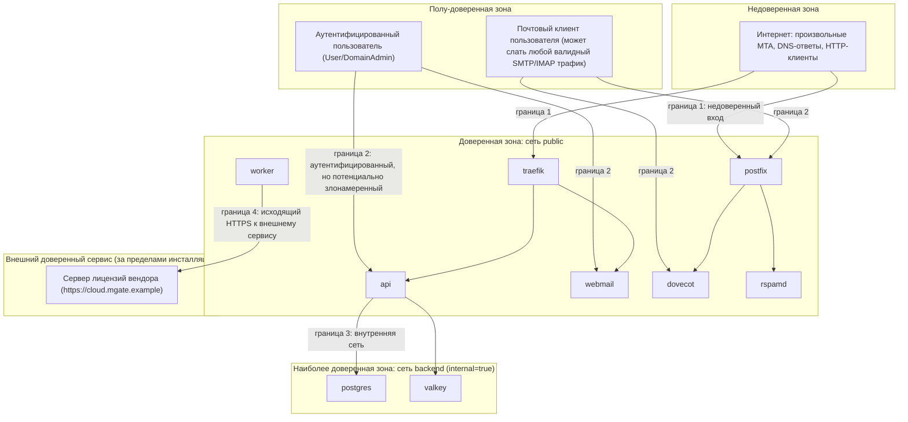

# Модель угроз почтовой платформы MGate

> Короткая англоязычная политика раскрытия уязвимостей — в корневом
> [`SECURITY.md`](../SECURITY.md). Этот документ — модель угроз (threat model) платформы:
> активы, границы доверия, STRIDE-анализ, меры защиты по компонентам, чек-лист хардненинга и
> план тестирования безопасности. Закрытый бэкенд (`api`, `webmail`, `worker`) описан здесь как
> «чёрный ящик»: через его границы, данные и наблюдаемое поведение, без внутреннего устройства.
> Меры, которые ещё не реализованы, явно помечены как планируемые.

## 1. Активы (assets)

Что защищаем, в порядке убывания критичности:

1. **Приватные ключи**: TLS-приватные ключи (`/certs/*/privkey.pem`), DKIM-приватные
   ключи (`domain_dkim_keys`, зашифрованы `MGATE_SECRET_KEY`; активные ключи подписи
   дополнительно хранятся в хранилище сервиса подписи (Valkey) и входят в состав его данных
   — доступ к Valkey нужно защищать так же, как доступ к БД), приватный ключ
   идентичности установки, используемый для лицензирования (хранится в БД, тоже зашифрован
   `MGATE_SECRET_KEY`), `MGATE_SECRET_KEY` сам (мастер-ключ шифрования на диске).
2. **Учётные данные пользователей**: пароли (argon2id-хэши), app-пароли,
   сессионные токены (в PostgreSQL, таблица `sessions`, хранится только SHA-256 хэш токена), cookie сессии.
3. **Содержимое почты**: письма в `/var/vmail` (конфиденциальность и целостность
   переписки всех доменов инсталляции — компрометация одного tenant'а не должна
   раскрывать письма другого, см. §3 многоарендность).
4. **Внутренние секреты доступа**: `MGATE_INTERNAL_TOKEN`, `DOVEADM_API_KEY`,
   `RSPAMD_CONTROLLER_PASSWORD`, `POSTGRES_PASSWORD`/`POSTGRES_MAIL_PASSWORD`,
   `VALKEY_PASSWORD`, `RESTIC_PASSWORD`, ключи облачных провайдеров бэкапа
   (`AWS_SECRET_ACCESS_KEY`).
5. **Репутация исходящего IP/домена**: способность инсталляции отправлять почту, не
   попадая в чёрные списки (актив всей платформы, а не только владельца — компрометация
   одного ящика и рассылка спама вредит доставляемости всех доменов на инсталляции).
6. **Целостность и доступность самого сервиса**: способность принимать/доставлять почту
   без DoS, без открытого релея, без backscatter.
7. **Лицензионное состояние**: аренда лицензии (Pro-статус) — актив для вендора
   (нарушение целостности = потеря дохода через клонирование инсталляций), не для
   конечного пользователя атаки, но входит в модель угроз, так как затрагивает
   канал связи, который проходит через инфраструктуру пользователя (см. §6).

## 2. Границы доверия (trust boundaries)

- **Граница 1** (Интернет → `postfix`/`traefik`): полностью недоверенный вход, самый
  большой периметр атаки. Всё, что приходит сюда, трактуется как враждебное, пока не
  доказано обратное (postscreen, rate limit, TLS).
- **Граница 2** (аутентифицированный пользователь → `api`/`webmail`/`postfix`/`dovecot`):
  пользователь предъявил валидные учётные данные, но остаётся недоверенным по
  отношению к: другим арендаторам (доменам), правам своей роли, содержимому
  отправляемых им данных (может быть скомпрометированный клиент, вредоносные вложения,
  инъекции в заголовки писем).
- **Граница 3** (`api`/`webmail`/`worker` → `postgres`/`valkey`): сеть `backend`
  без egress — компрометация процесса по эту сторону границы не даёт прямого выхода в
  интернет (см. ADR-0016), но даёт доступ ко всем данным всех арендаторов (наиболее
  ценная цель для горизонтального перемещения — SQL-инъекция в `api` эквивалентна
  компрометации всей БД).
- **Граница 4** (`worker`, а при активации и `api` → сервер лицензий вендора): единственный
  легитимный исходящий канал к внешнему сервису вендора за пределами инсталляции; входящих
  соединений от сервера лицензий в инсталляцию нет (см. §6).

## 3. Многоарендность (multi-tenancy) как сквозная угроза

MGate размещает несколько доменов (возможно, принадлежащих разным организациям, если
инсталляция это допускает) на одной инсталляции. Каждая из угроз ниже должна
рассматриваться и в контексте «Domain Admin домена A не должен получить доступ к
данным домена B» — это не отдельная категория STRIDE, а требование, применимое почти
ко всем строкам таблицы §4 (RBAC, авторизация запросов, доступ к почте).

## 4. STRIDE-анализ

| Категория | Угроза | Затрагиваемые компоненты | Меры защиты |
|-----------|--------|---------------------------|--------------|
| **Spoofing** | Подделка отправителя письма (envelope/From spoofing чужого домена) | postfix, rspamd | SPF/DKIM/DMARC-валидация входящей почты (Rspamd), `v_postfix_sender_login` ограничивает, от какого envelope-sender может слать аутентифицированный пользователь (запрет спуфинга собственных доменов изнутри) |
| **Spoofing** | Подмена внутреннего запроса (например, поддельный вызов `/internal/v1/dovecot/passdb` в обход Dovecot) | api (internal), dovecot | Bearer-токен `MGATE_INTERNAL_TOKEN` на каждый internal-вызов + сетевая сегментация (ADR-0016); internal API не проксируется Traefik |
| **Spoofing** | DNS-спуфинг (поддельные ответы DNSBL/SPF/DKIM lookups) | unbound, rspamd, postfix | DNSSEC-валидация в unbound (ADR-0017) |
| **Spoofing** | Session fixation / кража сессионной cookie веб-интерфейса | api, web SPA | `HttpOnly`, `Secure`, `SameSite=Strict` cookie с префиксом `__Host-` (`Path=/`, без `Domain`: браузер примет её только от этого хоста, соседний хост того же сайта не подложит свою сессию или CSRF-пару); запрос с повторённой cookie сессии или CSRF отклоняется `401`; регенерация session id при логине, короткий TTL + скользящее продление |
| **Tampering** | Модификация письма в очереди/на диске (Maildir) сторонним процессом в том же контейнере/хосте | postfix, dovecot, том vmail | `cap_drop: [ALL]` + минимальный `cap_add`, `no-new-privileges`, отдельный uid `vmail` 5000:5000, read-only root fs где возможно |
| **Tampering** | SQL-инъекция в API, дающая запись в чужие домены/ящики | api, webmail, worker, postgres | Только параметризованные запросы (bind-параметры, никогда конкатенация строк — обязательное правило кода бэкенда); авторизация на уровне доступа к данным (RBAC-проверка перед каждым запросом, не только на роутере) |
| **Tampering** | Подмена конфигурации Traefik/сертификатов через доступ к общим томам | traefik, том proxy-dynamic, certs | Тома монтируются только тем сервисам, которым нужны (принцип наименьших привилегий на уровне compose); запись в `/certs`/`/etc/traefik/dynamic` — только бэкендом (`api`/`worker`) при загрузке собственного сертификата |
| **Tampering** | Обход проверки лимита доменов Community-редакции через модификацию/патчинг закрытого бинарника или прямую запись в БД | закрытый бэкенд (состояние лицензии) | Исходный код бэкенда не публикуется вообще — тривиальный путь «форкнуть и вырезать проверку» отсутствует; честно принято, что патчинг скомпилированного бинарника решительным атакующим остаётся технически возможным. Подписанные вендором короткоживущие аренды, привязанные к установке (внутреннее устройство не публикуется, поведение — `docs/LICENSING.md`), серверная детекция клонов (`docs/LICENSING.md` §9), договорный запрет в `EULA.md` |
| **Repudiation** | Администратор отрицает действие (удаление ящика, изменение прав) | api, таблица audit_log | Таблица `audit_log` — обязательная запись каждого мутирующего действия админ-панели с actor/timestamp/diff; `login_events` для входов |
| **Repudiation** | Отсутствие журнала для internal-вызовов (кто вызвал passdb, когда) | api internal | `login_events` фиксирует попытки логина независимо от протокола (IMAP/POP3/SMTP AUTH), см. ADR-0004/0010 |
| **Information Disclosure** | XSS в веб-почте (вредоносный HTML во входящем письме читает cookie/токены другого домена/аккаунта) | webmail, web SPA | HTML писем рендерится в **sandboxed iframe** (без `allow-same-origin` в комбинации с `allow-scripts`), дополнительно санитайзинг через `ammonia` на бэкенде до отдачи клиенту (defense in depth: сервер убирает `<script>`/обработчики событий, iframe изолирует по origin даже если санитайзинг пропустит что-то); внешние изображения и внешние ресурсы блокируются по умолчанию |
| **Information Disclosure** | SSRF через прокси удалённых изображений («Показать изображения») | webmail | Прокси изображений (если реализован на сервере, а не через прямую загрузку браузером) обязан резолвить и проверять целевой адрес перед запросом, отклонять RFC1918/loopback/link-local/metadata-адреса (169.254.169.254 и аналоги облачных metadata-сервисов), не следовать редиректам на такие адреса — обязательное требование к реализации, не опция |
| **Information Disclosure** | Утечка писем одного домена через ошибку авторизации API/представлений | api, webmail, представления postgres | Каждый запрос к данным домена/ящика проверяет принадлежность вызывающего пользователя этому домену на уровне доступа к данным (не только роутера); `v_postfix_*`/`v_dovecot_userdb` не параметризуются пользовательским вводом из HTTP напрямую (это read-only SQL-карты для демонов, не HTTP-эндпоинт) |
| **Information Disclosure** | Секреты в логах (пароль в теле ошибки, токен в query string) | сервисы бэкенда (`api`, `webmail`, `worker`) | Структурированные логи с явным списком чувствительных полей, которые маскируются; секреты никогда не передаются в query string (только заголовки/тело) |
| **Information Disclosure** | Утечка приватных ключей DKIM/ключа установки из БД при компрометации `postgres` | postgres, бэкенд | Приватные ключи хранятся зашифрованными `MGATE_SECRET_KEY` (XChaCha20-Poly1305), не в открытом виде — компрометация одной только БД (без `MGATE_SECRET_KEY`) не раскрывает ключи |
| **Denial of Service** | Флуд входящих SMTP-соединений / брутфорс IMAP-логина | postfix, dovecot, api policy | postscreen (DNSBL, deep protocol tests), rate limiting в policy-сервисе бэкенда (`api:10040`, счётчики в Valkey), `mgate-agent --role firewall` — nftables-баны по данным Valkey (`mgate:bans`) |
| **Denial of Service** | Переполнение очереди Postfix спамом с уже скомпрометированного аккаунта (см. также Elevation ниже) | postfix, api policy | Rate limits на ящик/домен/IP (в час/в день); автоматическая приостановка при аномальном объёме исходящей почты — планируется (алгоритм детекции ещё не реализован) |
| **Denial of Service** | Amplification/backscatter: NDR-письма на поддельного отправителя из-за приёма для несуществующих локальных адресов | postfix, rspamd | `v_postfix_virtual_mailboxes`/`_aliases` — recipient verification на уровне SMTP (reject unknown recipient до приёма DATA, а не после — предотвращает backscatter в принципе) |
| **Denial of Service** | Ресурсное исчерпание при парсинге вредоносных вложений/писем в веб-почте | webmail | Лимиты размера сообщения (`MGATE_MESSAGE_SIZE_LIMIT`), таймауты парсинга, проверенная библиотека разбора MIME (`mail-parser`) вместо самописного парсера |
| **Elevation of Privilege** | User получает права DomainAdmin/SuperAdmin через баг в проверке ролей | api | Централизованная проверка ролей на уровне каждого запроса (middleware), а не разбросанные ad-hoc проверки по отдельным обработчикам; тесты авторизации — обязательная часть набора тестов (не только happy path) |
| **Elevation of Privilege** | Скомпрометированный аккаунт пользователя используется для рассылки спама/фишинга (open relay через легитимную аутентификацию) | postfix, api policy, rspamd | Rate limits (см. DoS выше), `v_postfix_sender_login` (нельзя слать от чужого имени), Rspamd продолжает проверять исходящую почту так же, как входящую (антиспам не отключается для аутентифицированных пользователей) |
| **Elevation of Privilege** | Container escape из скомпрометированного почтового процесса (Postfix/Dovecot/Rspamd бинарник с уязвимостью) на хост | все контейнеры | `cap_drop: [ALL]` + точечный `cap_add`, `security_opt: [no-new-privileges:true]`, read-only root fs где возможно, непривилегированные пользователи в образах (не root), актуальные базовые образы (`debian:trixie-slim`), пересобираемые при выпуске релизов |
| **Elevation of Privilege** | Подмена TLS-сертификата сервера: загрузка чужого или недействительного сертификата | api, worker, traefik | Загрузка сертификата доступна только SuperAdmin, запрос защищён CSRF-токеном; бэкенд проверяет цепочку, срок действия и принадлежность приватного ключа сертификату, приватный ключ хранится в БД в зашифрованном виде. Автоматический выпуск (ACME) валидирует домены через HTTP-01 (токены во временном хранилище Valkey) или DNS-01, приватные ключи шифруются мастер-ключом |
| **CSRF** | Межсайтовый запрос от имени залогиненного администратора (изменение настроек домена через чужую страницу) | web SPA, api | Session-cookie аутентификация **обязательно** сопровождается CSRF-токеном (double-submit: cookie `__Host-mgate_csrf` + заголовок `X-CSRF-Token`, см. `web/apps/spa/src/lib/apiClient.ts`); `SameSite=Strict` как базовая защита + явный CSRF-токен как основной механизм (не полагаться только на SameSite) |
| **TLS downgrade** | Понижение до устаревших протоколов/шифров на публичных портах | traefik, postfix, dovecot | Traefik: набор TLS options `modern` (мин. TLS1.3) для админки/веб-почты по умолчанию, общий дефолт мин. TLS1.2 с современными шифронаборами; Postfix порт 25 сознательно остаётся opportunistic TLS с приёмом TLS1.2 (входящая межсерверная почта не может требовать TLS1.3 — многие внешние MTA не поддерживают его, а STARTTLS на 25 в принципе не может быть принудительным без риска потери почты — задокументированная особенность, не недосмотр) |

## 5. Хардненинг — чек-лист

Базовый чек-лист, применяемый ко всем first-party образам/сервисам (здесь фиксируется
обязательный минимум; детали — в документации конкретных компонентов):

- [x] `restart: unless-stopped` на каждом сервисе (зафиксировано в `docker-compose.yml`).
- [x] Healthcheck на каждом сервисе (`docker compose ps` показывает `healthy` для postgres, valkey, traefik, web, api, worker).
- [x] `cap_drop: [ALL]` + минимально необходимый `cap_add` (`firewall` — `NET_ADMIN, NET_RAW`; почтовые демоны с минимальным набором).
- [x] `security_opt: [no-new-privileges:true]` везде в `docker-compose.yml`.
- [x] Read-only root filesystem для `api`/`webmail`/`worker`/`traefik` (с явными `tmpfs`/volume-исключениями).
- [x] Непривилегированный пользователь (не `root`, не uid 0) в каждом first-party образе (включая `vmail:5000:5000`).
- [x] Логирование `json-file`, `max-size: "10m"`, `max-file: "5"` в compose-конфигурации.
- [x] `stop_grace_period` (30–60с) для postfix/dovecot для завершения активных сессий без потерь.
- [x] Секреты только через переменные окружения/`*_FILE`/docker secrets (`scripts/gen-secrets.sh`, `.env`).
- [x] `npm audit` в CI для `web/`. Аудит зависимостей бэкенда выполняется вендором в процессе его сборки.
- [x] Базовые образы пиннятся по тегу с известной датой сборки (`debian:trixie-slim`, alpine).
- [ ] SBOM для образов дистрибутива — в текущем процессе выпуска вместе с релизом не публикуется.
- [x] Все внутренние HTTP-эндпоинты (`:8081`, doveadm, rspamd controller) проверяют bearer-токен/пароль независимо от сетевой позиции (ADR-0016).
- [x] CSP-заголовки на статике SPA и на выдаче писем веб-почты (`script-src 'self'`, iframe sandbox без `allow-scripts` + `ammonia` backend sanitization).
- [x] Cookie сессии: `__Host-mgate_session` — `HttpOnly`, `Secure`, `SameSite=Strict`, `Path=/`, без
  `Domain` — для admin/account и webmail; CSRF-cookie `__Host-mgate_csrf` с теми же атрибутами,
  кроме `HttpOnly`.

## 6. Особый случай: канал лицензирования как потенциальная угроза

Хотя лицензирование — не угроза безопасности пользователя в классическом смысле, канал
`worker → сервер лицензий` заслуживает отдельного рассмотрения, так как это единственный
исходящий канал к серверу вендора, встроенный в продукт:

- **Что если сервер лицензий скомпрометирован или подделан (DNS-спуфинг
  `https://cloud.mgate.example`)?** Транспорт — HTTPS, а кроме того установка проверяет каждый
  ответ сервера лицензий и принимает только аренды, выпущенные вендором (внутреннее
  устройство этой проверки не публикуется). Поддельный сервер не может выдать
  действительную аренду — максимум, что он может сделать, это отказать в обслуживании
  (недоступность), что ведёт к `ProOffline`/`CommunityDegraded` по публичной политике
  (`docs/LICENSING.md` §6), а не к компрометации инсталляции.
- **Что если инсталляция никогда не связывается с сервером лицензий?** Это не угроза, а
  штатный режим (`Community`, либо `ProOffline` до истечения аренды) — см.
  `docs/LICENSING.md` §6.
- **Может ли сервер лицензий инициировать соединение к инсталляции?** Нет — обмен
  строго клиент-инициируемый (`worker` периодически опрашивает статус активации и
  продлевает лицензию); инсталляция не открывает порт для входящих запросов от
  лицензионного сервера. Это архитектурно исключает сервер лицензий как вектор атаки на
  входящий периметр инсталляции.
- Модель угроз самого сервера лицензий и биллинга вендора — вне области этого документа:
  здесь рассматривается только клиентская сторона, то есть сама инсталляция. Какие данные
  инсталляция передаёт вендору — `docs/LICENSING.md` §5.

## 7. План тестирования безопасности

Здесь фиксируется, что именно должно быть проверено и каким способом, а не сами тесты:
сценарии почтового стека и сквозные проверки лежат в `tests/` этого репозитория, тесты
закрытого бэкенда входят в его собственный процесс сборки.

| Проверка | Инструмент/метод | Что подтверждает |
|----------|-------------------|-------------------|
| Открытый релей | Отправка письма для чужого домена от неаутентифицированного клиента с внешнего IP (`tests/deliverability/`) | Postfix отклоняет relay для неизвестных доменов/адресов |
| Recipient verification / backscatter | Отправка на несуществующий локальный адрес | SMTP reject до приёма DATA (не NDR-backscatter) |
| Доставляемость | mail-tester.com (цель: 10/10), проверка SPF/DKIM/DMARC живых доменов | Корректность подписи/публикации DNS-записей end-to-end |
| Rate limiting / брутфорс | Скриптованный перебор паролей IMAP/SMTP AUTH с одного IP | Бан срабатывает, легитимные пользователи не блокируются ложноположительно |
| Авторизация API (RBAC) | Автоматизированный набор тестов: попытка User получить данные другого домена/DomainAdmin-эндпоинты | Ни один эндпоинт не отдаёт данные вне прав пользователя |
| SQL-инъекция | Тесты бэкенда с edge-case вводами в текстовые поля (адреса, темы писем, заголовки) + статический анализ | Параметризация запросов держится, инъекция невозможна |
| XSS в веб-почте | Тестовый набор писем с известными XSS-пейлоадами (mXSS, событийные обработчики, `javascript:` URI, SVG-скрипты) | `ammonia` + sandboxed iframe не пропускают исполнение |
| SSRF через image proxy | Письма с `` на `169.254.169.254`, `127.0.0.1`, RFC1918-адреса, редиректы на них | Прокси отклоняет либо не резолвит такие адреса |
| CSRF | Автоматизированный запрос без CSRF-токена/с чужого origin к мутирующим эндпоинтам | Запрос отклоняется |
| TLS-конфигурация | `testssl.sh` / `nmap --script ssl-enum-ciphers` на 443/587/993 | Соответствие заявленным минимальным версиям/шифронаборам (§4, TLS downgrade) |
| Контейнерный хардненинг | `docker scout` / `trivy` образ-сканирование, ручная проверка чек-листа §5 — перед каждым релизом образов | Отсутствие известных CVE в базовых слоях, чек-лист соблюдён |
| Лицензионный клиент | Тесты бэкенда: некорректные, повреждённые и поддельные ответы сервера лицензий, конфликт копий установки | Клиент отклоняет некорректные ответы, не падает в небезопасное состояние (никогда не расширяет набор доступных функций без действительной аренды) |
| Зависимости / supply chain | `npm audit` в CI (`web/`), аудит зависимостей бэкенда | Нет известных уязвимых версий в графе зависимостей |
| Секреты в репозитории | `gitleaks`/аналог в pre-commit или CI | Ни один секрет не закоммичен |
| Внешний аудит | Ручной penetration test (сторонняя команда либо тщательный самостоятельный аудит по этому документу) | Независимая проверка перед первым публичным релизом |

## 8. Самопроверка по OWASP ASVS v4.0.3 L2 (не является внешним аудитом)

Таблица ниже — самопроверка архитектуры по категориям **OWASP ASVS v4.0.3 Level 2 (Applications that contain sensitive data)**, выполненная вендором; независимый внешний аудит не проводился (см. §7). «Соответствует по проекту» означает, что мера предусмотрена архитектурой; не реализованные полностью меры помечены как планируемые. Таблица не является гарантией соответствия стандарту или сертификатом.

| Категория ASVS | Описание требования | Оценка по проекту | Подтверждение / Реализация |
|----------------|----------------------|--------|----------------------------|
| **V1 Архитектура и дизайн** | Модель угроз, границы доверия, сегментация сетей | соответствует по проекту | Документирована в §1–§4 данного файла. ADR-0016: изолированная сеть `backend` (без egress), Traefik как единый ingress, фиксированная схема портов ([ARCHITECTURE.md](ARCHITECTURE.md) §4). |
| **V2 Аутентификация** | Стойкое хэширование паролей, защита от брутфорса, 2FA | частично — 2FA в разработке | Argon2id с параметрами RFC 9106. Брутфорс-бан через policy-сервис бэкенда и nftables (`mgate:bans`). App-пароли для почтовых клиентов. **Двухфакторная аутентификация (TOTP) в этой версии не работает**: вход выполняется только по паролю, одноразовый код не запрашивается и не проверяется; подключение 2FA в интерфейсе отключено до реализации. |
| **V3 Управление сессиями** | Криптостойкие токены, cookie-флаги, тайм-ауты, отзыв | соответствует по проекту | 256-битные случайные токены (в PostgreSQL хранится только SHA-256 хэш токена). Флаги `HttpOnly; Secure; SameSite=Strict; Path=/`, префикс `__Host-` (без `Domain`). Немедленная инвалидация при логауте и смене пароля. |
| **V4 Контроль доступа (RBAC)** | Авторизация на каждом запросе, изоляция арендаторов | соответствует по проекту | Централизованная проверка ролей (SuperAdmin / DomainAdmin / User) на каждом запросе. Мультиарендность: проверка владения ресурсом на уровне SQL-запросов. |
| **V5 Валидация и санитайзинг** | Защита от SQLi, XSS, SSRF, инъекций заголовков | частично — прокси изображений планируется | Только параметризованные SQL-запросы. Почтовый HTML санитизируется `ammonia` + отображается в `<iframe sandbox>` без `allow-scripts`. Серверный прокси удалённых изображений (с SSRF-защитой, §4) планируется; пока он не реализован, сервер удалённые изображения не проксирует. |
| **V6 Криптография** | Шифрование at-rest, стойкие ключи, безопасный генератор | соответствует по проекту | XChaCha20-Poly1305 для приватных ключей DKIM, ключей загруженных TLS-сертификатов и других секретов в БД (`MGATE_SECRET_KEY`). RSA ≥2048 бит для DKIM. Криптографически стойкий системный генератор случайных чисел. |
| **V7 Логирование и ошибки** | Отсутствие утечек секретов в логах, корреляция | соответствует по проекту | Структурированные логи с маскированием паролей и токенов. Уникальный UUID `request_id` во всех HTTP-ответах. Обезличенные тексты ошибок для клиентов. |
| **V8 Защита данных** | Безопасность секретов при развёртывании | соответствует по проекту | Отсутствие запечённых секретов в образах. Генерация стойких секретов через `scripts/gen-secrets.sh`. Поддержка Docker secrets / `*_FILE`. |
| **V9 Коммуникации (TLS)** | Современные версии TLS, HSTS, автоматический выпуск сертификатов | соответствует по проекту | TLS 1.2+ и TLS 1.3 с современными cipher suites. Встроенный ACME-клиент бэкенда (`MGATE_ACME_ENABLED=true`) автоматически заказывает и продлевает сертификаты в Let's Encrypt / ZeroSSL (HTTP-01, DNS-01); поддерживается загрузка собственных сертификатов через админку. |
| **V10 Вредоносный код / Supply Chain** | Аудит зависимостей, минимальные контейнеры | соответствует по проекту | Проверка зависимостей (`cargo audit`, `npm audit`) предусмотрена процессом сборки и релиза (см. §7). Базовые образы `debian:trixie-slim` и `alpine`. |
| **V11 Бизнес-логика** | Лимиты редакции, квоты, защита от спама | соответствует по проекту | Лимит доменов Community (1 домен) проверяется на сервере, в бэкенде. Квоты почтовых ящиков, лимиты отправки писем в час/день, rate limiting. |
| **V12 Безопасность файлов** | Ограничение размера вложений, безопасный парсинг | соответствует по проекту | Строгие лимиты размера MIME-сообщений (`MGATE_MESSAGE_SIZE_LIMIT`). Использование проверенного парсера `mail-parser`. |
| **V13 API и Web Services** | REST, CSRF-защита, строгая валидация схем | соответствует по проекту | OpenAPI 3.1 спецификация. Двойная CSRF-защита (Cookie + заголовок `X-CSRF-Token`). Строгая десериализация JSON. |
| **V14 Конфигурация** | Контейнерный хардненинг, drop capabilities | соответствует по проекту | `cap_drop: [ALL]`, `security_opt: [no-new-privileges:true]`, read-only root filesystems, непривилегированные пользователи в контейнерах. |

## 9. Смежные документы

[`ARCHITECTURE.md`](ARCHITECTURE.md) (топология, потоки данных, порты),
[`CONFIGURATION.md`](CONFIGURATION.md) (переменные окружения),
[ADR-0016](adr/0016-network-segmentation-internal-auth.md) (сегментация сети),
[`LICENSING.md`](LICENSING.md) (лицензирование: передаваемые данные, офлайн-поведение),
корневой [`SECURITY.md`](../SECURITY.md) (политика раскрытия уязвимостей).
